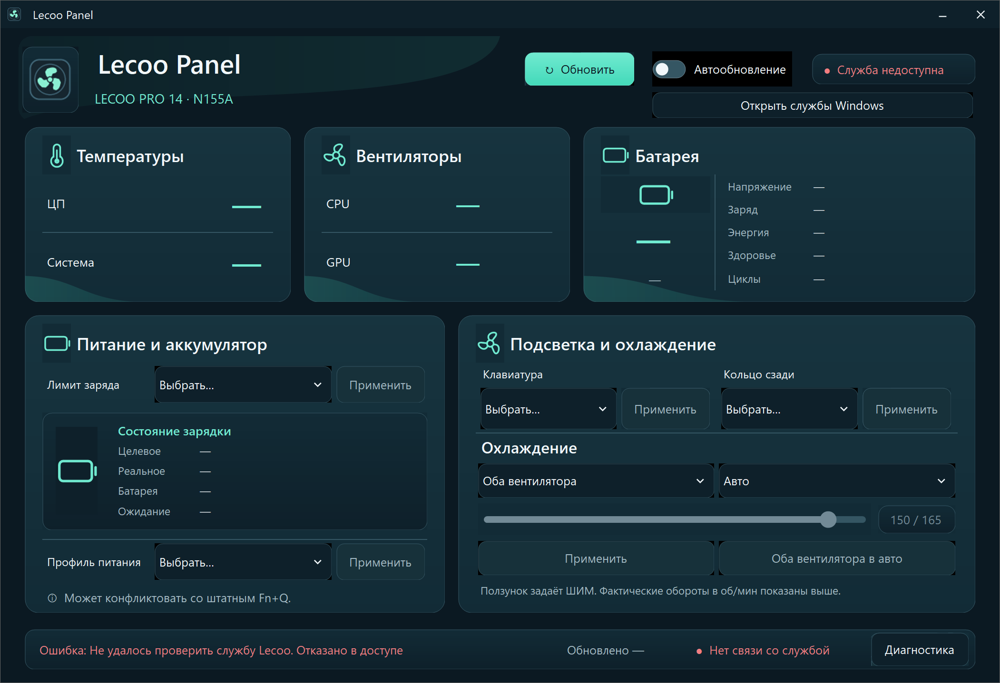

# Lecoo Panel

Сторонний Windows-интерфейс для [Lecoo Control Center v0.6.0](https://github.com/LaVashikk/Lecoo-Control-Center/releases/tag/v0.6.0). Показывает температуры, обороты вентиляторов и состояние батареи. Позволяет менять охлаждение, лимит заряда, профиль питания и подсветку. Целевая модель — Lecoo Pro 14 AMD (N155A).

Установи службу из оригинального ZIP. Скачай [LecooPanel.exe](https://github.com/Kip-21/Lecoo-Panel/releases/tag/v0.1.0-preview), положи рядом с `lecoo-ctrl.exe` и запусти.

Сборка — `.\Build.ps1` (.NET Framework 4.8).
